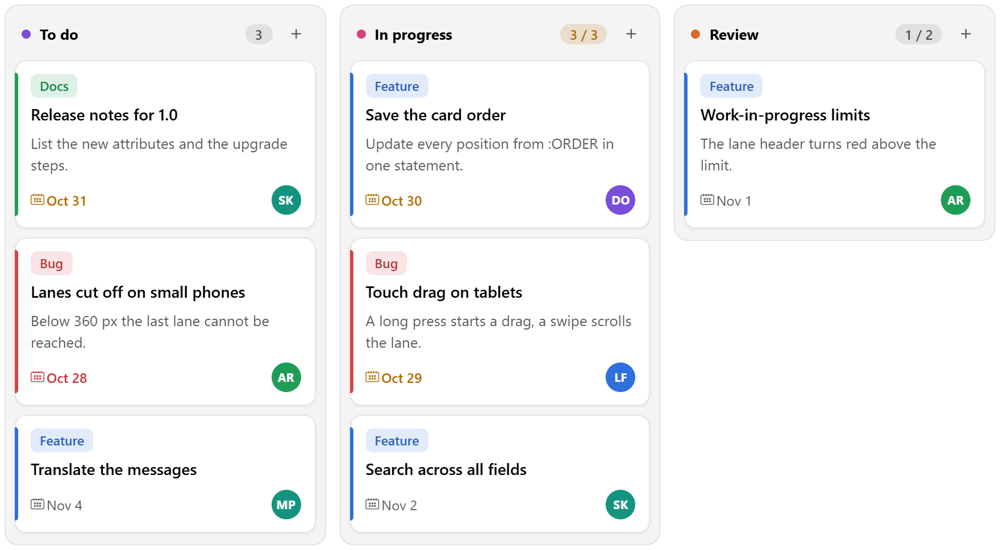

# Kanban Board for Oracle APEX

Cards in status lanes that users drag to a new lane or position, saved with your own PL/SQL.

[](https://oracleapex.com/ords/r/aamirkhanz/plugins/kanban) &nbsp; Sign in as `demo` with the password `Demo`.



| | |
|---|---|
| **Type** | Region plug-in |
| **Internal name** | `COM.TECHREVX.KANBAN` |
| **Version** | 1.0 |
| **Requires** | Oracle APEX 26.2 or later |
| **License** | MIT |

## What it does

Kanban Board shows the rows of any query as cards in status lanes. Users drag a card to another lane or position, and your PL/SQL saves the move. Tasks, tickets, leads, orders and approvals all fit.

- **Drag and drop**: mouse, touch (long press) and keyboard. Ctrl+Left and Ctrl+Right move the focused card to the next lane, Ctrl+Up and Ctrl+Down within the lane.
- **Saving**: the Move Code gets the card, the new lane, its position and the order of the whole lane. If it raises an error, the card moves back and the message is shown.
- **Work-in-progress limits**: give a lane a limit; its counter turns amber when full and the lane turns red above it.
- **Cards**: label with its own color, title, three lines of description, due date (red when overdue, amber when due within two days) and the assignee's initials.
- **Search**: filters cards by title, description, assignee or label while you type.
- **Events**: Card Moved, Card Clicked (optionally setting a page item) and Add Card per lane, for Dynamic Actions.

## At a glance

- **Source**: any region source with one row per card. Map ID, Title and Status; Description, Assignee, Due Date, Label and Color are optional. Cards appear in each lane in the order of the query.
- **Lanes**: listed in Columns as value:Label or value:Label:limit (work-in-progress limit), or one per status found in the data.
- **Moving**: drag with mouse or touch, or press Ctrl+Left / Ctrl+Right on a focused card. The Move Code gets :ID, :STATUS, :POSITION and :ORDER; if it fails the card moves back.
- **Features**: search box, card counts and limits, add buttons per lane, overdue and due-soon dates, assignee initials, colored labels.
- **JavaScript**: apex.region( "id" ).refresh(). Events: Kanban - Card Moved, Card Clicked and Add Card.

## Installation

1. Download `plugin/region_type_plugin_com_techrevx_kanban.sql` from the [latest release](https://github.com/aamirkhanz/apex-plugin-kanban-board/releases/latest) (or from this repository).
2. In App Builder, open your application and go to **Shared Components > Plug-ins**.
3. Choose **Import**, select the file and finish the wizard.
4. Create a region of type **Kanban Board [Plug-in]**, write the query and map ID, Title and Status.

Everything the plug-in needs is inside the SQL file, including SortableJS; it loads nothing from other sites.

## Example

```sql
select task_id, title, status, description, assignee, due_date, label
  from tasks
 where project_id = :P30_PROJECT
 order by position
```

```sql
-- Move Code
update tasks
   set status   = :STATUS,
       position = ( select o.pos
                      from ( select column_value as id, rownum as pos
                               from table( apex_string.split( :ORDER, ',' ) ) ) o
                     where o.id = to_char( tasks.task_id ) )
 where task_id in ( select column_value from table( apex_string.split( :ORDER, ',' ) ) );
```

Before the Move Code runs, :ID is checked against the region's own query, so users can only move cards they can see.

## Attributes

### Data

| Attribute | Type | Default | Description |
|---|---|---|---|
| **ID Column** (required) | Region source column |  | Unique key of each card, available as :ID in the Move Code. |
| **Title Column** (required) | Region source column |  | Card heading. |
| **Status Column** (required) | Region source column |  | The column (lane) a card is in, for example TODO or DONE. Cards appear in each lane in the order of the query. |
| **Description Column** | Region source column |  | Optional text under the title, shortened to three lines. |
| **Assignee Column** | Region source column |  | Optional person shown as initials in a colored circle; the full name is in the tooltip. |
| **Due Date Column** | Region source column |  | Optional due date. Overdue cards show it in red, cards due within two days in amber. |
| **Label Column** | Region source column |  | Optional tag on the card, such as Bug, Feature or High. |
| **Color Column** | Region source column |  | Optional CSS color for the label and the card's edge. Without it, each label text gets its own color. |

### Board

| Attribute | Type | Default | Description |
|---|---|---|---|
| **Columns** | Text |  | The lanes in order, as value:Label or value:Label:limit, separated by commas. The limit is the work-in-progress limit; the lane header turns red above it. Leave empty to make one lane per status found in the data. |
| **Features** | Checkboxes | `drag:search:counts:add` | Drag and Drop: move cards with the mouse, touch, or Ctrl+Arrow keys. Search: a box that filters cards by any text. Counts: the number of cards (and the limit) in each lane header. Add Buttons: a + button per lane that fires Kanban - Add Card. Values: `drag` Drag and Drop, `search` Search, `counts` Counts, `add` Add Buttons. |
| **Set Item on Click** | Page item |  | Page item set to the card's ID when a card is clicked (or Enter is pressed on it), before Kanban - Card Clicked fires. Use it to open a dialog for the card. |
| **Lane Width** (required) | Integer | `290` | Minimum width of each lane. Lanes share any extra space in the region; when they do not fit, the board scrolls sideways. |
| **Height** (required) | Integer | `600` | Height of the board; each lane scrolls on its own. |

### Saving

| Attribute | Type | Default | Description |
|---|---|---|---|
| **Move Code** | PL/SQL code |  | PL/SQL run when a card is dropped. :ID is the card, :STATUS the new lane, :POSITION its place in the lane (1 = top) and :ORDER the IDs of the lane's cards in their new order, comma separated. If it fails, the card moves back. Leave empty to only fire the Kanban - Card Moved event. |

## Events

Available in Dynamic Actions, and as jQuery events on the region or item:

- **Kanban - Add Card** (`tx-kanban-add`)
- **Kanban - Card Clicked** (`tx-kanban-click`)
- **Kanban - Card Moved** (`tx-kanban-move`)

## Move Code

Runs when a card is dropped, with these bind variables. To refuse a move, call raise_application_error: the Move Code's changes are rolled back, the card goes back to where it was and your message is shown. Other errors show a general message and are written to the debug log.

```text
:ID        the card's ID, checked against the region's query first
:STATUS    the lane it was dropped in
:POSITION  its place in that lane, 1 = top
:ORDER     the IDs of all cards in that lane, in their new order, comma separated
```

```sql
-- refuse moves into a full lane
declare
    l_count number;
begin
    select count(*) into l_count from tasks where status = :STATUS and task_id <> :ID;
    if :STATUS = 'DOING' and l_count >= 3 then
        raise_application_error( -20000, 'In progress already has 3 tasks.' );
    end if;
    update tasks set status = :STATUS where task_id = :ID;
end;
```

## Events and JavaScript

```text
Kanban - Card Moved     after a move (and the Move Code); this.data = { id, status, from, position, order }
Kanban - Card Clicked   click or Enter on a card; this.data = { id, card }
Kanban - Add Card       the + button of a lane; this.data = { status, label }
```

To open a form for a card, set Set Item on Click to a hidden item and add a Dynamic Action on Kanban - Card Clicked that opens the dialog page with that item. After the dialog closes, refresh the region.

```javascript
apex.region( "board" ).refresh();                  // read the query again
apex.region( "board" ).getCards();                 // [ { id, t, s, d, a, due, l, c } ]
apex.region( "board" ).moveCard( "42", "DONE", 1 ); // move and save like a drop
```

### Keyboard

```text
Arrow keys            move the focus between cards
Ctrl+Left, Ctrl+Right move the card to the previous or next lane (top)
Ctrl+Up, Ctrl+Down    move the card up or down in its lane
Enter                 click the card
```

### Styling

The board uses the Universal Theme colors. Override `--tx-kb-danger` and `--tx-kb-warn` on `.tx-Kanban` for the limit colors; cards are `.tx-Kanban-card` with the label color in `--tx-kb-card`.

## Included libraries

| Library | Version | License |
|---|---|---|
| [SortableJS](https://sortablejs.github.io/Sortable/) | 1.15.7 | MIT |

See [THIRD-PARTY-NOTICES.md](THIRD-PARTY-NOTICES.md).

## Repository contents

- `plugin/region_type_plugin_com_techrevx_kanban.sql`: the plug-in, ready to import
- `src/`: the plug-in's own source (PL/SQL in `plugin.pls`, JavaScript and CSS), for reading and reviewing; the SQL file already contains it
- `apexplugin.json`: the plug-in's details for [apex.world](https://apex.world)

## License

MIT, see [LICENSE](LICENSE). The included libraries keep their own licenses.

## More plug-ins

Documentation, updates and more plug-ins for Oracle APEX: [www.techrevx.com](https://www.techrevx.com)
